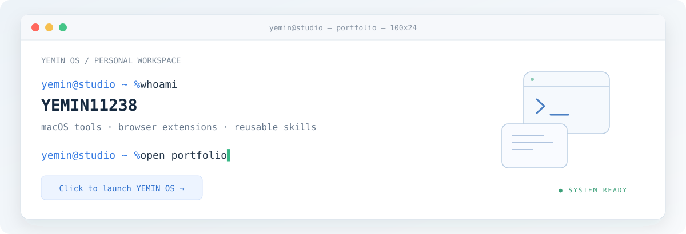

# 你好，我是张俊豪 👋

终端动画会自动播放 · 点击进入张俊豪的个人网站

我围绕 AI 产品与 Agent 工作流做设计和开发。 
近期在做 AI 工作台、视频创作工具、个人助手和像素游戏。 
从具体的使用场景出发，把想法做成可以打开、下载和体验的作品。

🌐 [个人网站](https://yemin11238.github.io/) · 📕 [小红书](https://www.xiaohongshu.com/user/profile/60bcd4b20000000001002d49) · 🐙 [GitHub](https://github.com/YEMIN11238)

---

## ⭐ Featured projects

近期持续打磨的四个项目，从 Agent 执行、视频创作到个人助手与 AI 伙伴游戏。

🛠️ [**AIPM Workbench**](https://github.com/YEMIN11238/AIPM-Workbench) 
面向 AI 产品经理的 macOS AI Coding 与 Agent 工作台。 
把需求讨论、文件、代码执行与产物放在同一个工作台，支持产品开发、公司调研和视频创作。 
[产品介绍与任务回放](https://yemin11238.github.io/AIPM-Workbench/)

🎬 [**CinePilot**](https://github.com/YEMIN11238/CinePilot) 
面向漫剧与短片制作的 AI Video Agent Demo。 
用节点画布组织故事、角色与分镜，逐镜修改与采用候选，再通过时间轴剪辑、编辑字幕并导出 MP4。 
[功能与本地运行](https://github.com/YEMIN11238/CinePilot#readme)

🤖 [**MioBot**](https://github.com/YEMIN11238/MioBot) 
把聊天、人设、记忆、联网和一次性提醒收进同一个界面的个人 AI 助手。 
支持独立助手与多模型连接，提供桌面、浏览器界面及云端服务代码，目前为源码预览版。 
[功能与运行说明](https://github.com/YEMIN11238/MioBot#readme)

🌲 [**Mosslume**](https://github.com/YEMIN11238/Mosslume) 
围绕探索、采集、制作与 AI 伙伴生活展开的像素生存建造游戏。 
与拥有对话和事件记忆的伙伴建设营地，持续完善伙伴协作与探索体验，目前为开发中的可玩原型。 
[实机画面与开发进展](https://github.com/YEMIN11238/Mosslume#readme)

更多作品 · [个人网站作品集](https://yemin11238.github.io/#works)

---

## ✍️ Writing & notes

📕 [在小红书找到我](https://www.xiaohongshu.com/user/profile/60bcd4b20000000001002d49)

项目的使用说明、更新与实现记录，也整理在各自的仓库中。

- [AIPM Workbench · 产品设计与能力验证](https://github.com/YEMIN11238/AIPM-Workbench/blob/main/docs/PRODUCT.md)
- [CinePilot · 工作流与验证记录](https://github.com/YEMIN11238/CinePilot/blob/main/docs/verification.md)
- [MioBot · 开发与验证说明](https://github.com/YEMIN11238/MioBot/blob/main/docs/DEVELOPMENT.md)
- [Mosslume · 实机进展与开发说明](https://github.com/YEMIN11238/Mosslume/blob/main/docs/DEVELOPMENT.md)

---

## About

- AI 产品设计与 Agent 工作流
- AI Coding 工作台与视频创作工具
- 个性化助手、记忆与任务体验
- 像素游戏、AI 伙伴与交互设计

---
